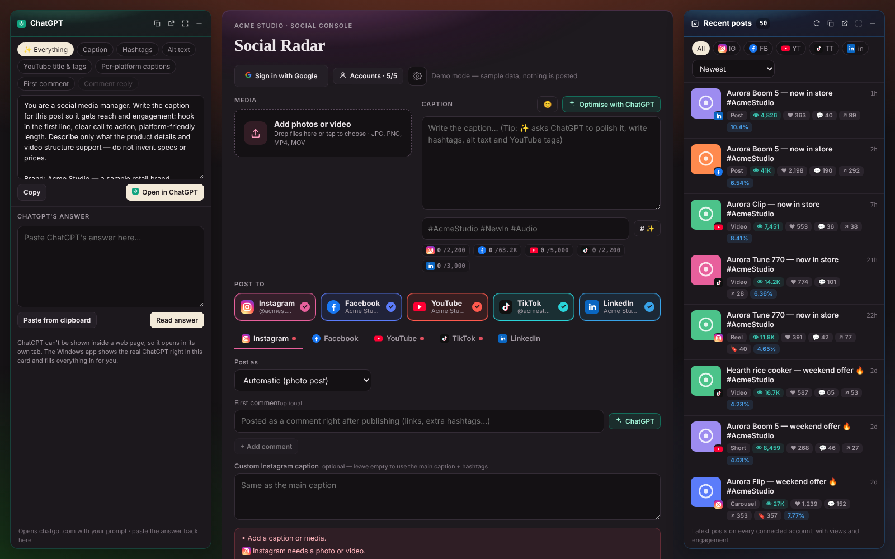

# Social Radar

A single console for running a brand's social media: write once, publish to **Instagram, Facebook, YouTube, TikTok and LinkedIn**, then track results, reply to comments and read messages in the same place.

> **Showcase edition.** This is a cleaned copy of a tool I built for my own work. Brand names, product catalogue, contact details and account identifiers are replaced with a fictional brand ("Acme Studio"). It runs in **demo mode** with sample data, so nothing real is ever posted.



## What it does

- **One composer.** Photos, videos, carousels, Reels and Stories; per-platform tabs for captions, hashtags, privacy, first comment and alt text; a live checklist catches problems before you post.
- **Analytics.** Followers, views and engagement per platform, plus a "recent posts" feed across every account.
- **Comments and inbox.** Read, reply to and hide comments; read and answer Instagram and Messenger messages from one list.
- **Stories editor.** Canvas editor for text, emoji and links, with a hand-off to the phone for stickers the APIs don't expose.
- **Link-in-bio page**, hosted from the same app, with click counts and a QR code.
- **Video clipping.** Scene detection in the browser to cut short clips from long videos.
- **ChatGPT helper.** Builds prompts from the draft and brand voice for captions, hashtags, alt text and YouTube tags, and reads the answer back in.

## How it's built

- **Front end:** vanilla ES modules, no framework and no build step for the app itself. A small `h()` helper for DOM, cards laid out in a draggable grid, all state in the browser (optionally synced through the user's own Google Drive).
- **Back end:** a handful of serverless functions in `api/` (OAuth callbacks, token exchange, media hosting, link-in-bio). One entry file, `server.js`, runs them locally and on Vercel.
- **Platform APIs:** Meta Graph (Instagram and Facebook Pages), YouTube Data API, TikTok Content Posting, LinkedIn.
- **Storage:** Vercel Blob hosts media at a URL the platforms can fetch; no database and no personal data kept on the server.
- **Security:** optional passcode gate, tokens kept in the browser only, API secrets in environment variables.

## Things I learned while building it

- Every platform's API has gaps a phone app doesn't have, so the app is honest about them and hands those steps to the phone.
- Platform review matters: unaudited YouTube and TikTok apps can only post privately, and Meta apps in development mode show posts only to people with an app role.
- Meta's App Review expects a complete screen recording of the login, permission grant and end-to-end use, with an English interface and captions.

## Try it

```bash
npm install
npm run demo        # open http://localhost:3000/?demo=1 — sample data, nothing is posted
```

To connect real accounts you need your own developer apps for each platform. Setup steps are in [`docs/SETUP.md`](docs/SETUP.md) and the variables are listed in [`.env.example`](.env.example). The privacy and terms pages are templates; replace them before using real accounts.

## Notes

The product catalogue in `public/products.js` and the link-in-bio defaults are sample data. Replace them with your own.
